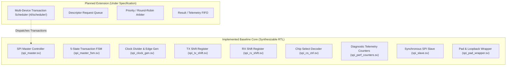
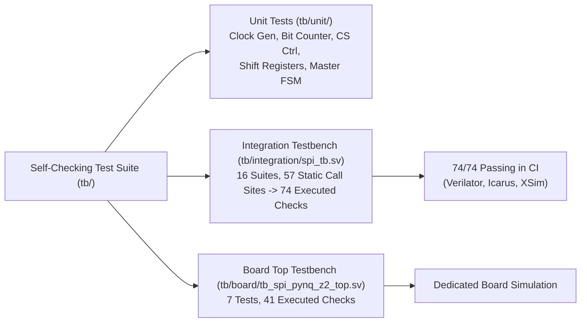

# Parameterized SPI IP Core with Multi-Device Transaction Scheduling and SystemVerilog Verification

## 1. Project Introduction

The **Parameterized SPI IP Core** is a modular, technology-independent digital IP core written in synthesizable SystemVerilog. Serial Peripheral Interface (SPI) is an industry-standard, synchronous, full-duplex communication protocol widely utilized across embedded computing, digital signal processing, and FPGA systems to connect host processors with sensors, memories, data converters, and peripheral controllers.

This project provides a clean, parameterizable hardware baseline capable of operating across all 4 standard SPI modes, supporting arbitrary word widths (verified for 1, 8, 16, and 32 bits), configurable clock division, glitch-free multi-peripheral chip selection, and non-intrusive diagnostic telemetry. The repository is structured to serve as an authoritative, reproducible foundation for academic digital design, FPGA prototyping on the **TUL PYNQ-Z2** (AMD Zynq-7020) development board, and future exploration of an autonomous **Multi-Device Transaction Scheduler**.

---

## 2. Problem Statement

Standard vendor-provided SPI IP cores (such as AXI Quad SPI) often introduce considerable overhead, requiring full AXI4/AXI4-Lite interconnect infrastructure and vendor-specific tool dependencies. Conversely, basic open-source SPI implementations are frequently hardcoded to fixed word widths (e.g., 8-bit only), fixed clock polarities (Mode 0), and single-slave connections. Many naive designs inadvertently introduce clock-domain crossing hazards by routing the serial clock ($SCLK$) directly into asynchronous register clocks, or suffer from output glitches on chip-select signals.

Furthermore, in multi-peripheral environments where an FPGA must simultaneously communicate with heterogeneous devices (e.g., high-rate motion sensors operating at Mode 3 alongside non-volatile EEPROMs operating at Mode 0), traditional controllers force the host software to perform tedious manual arbitration and polling.

To address these challenges, this project engineers a vendor-agnostic, fully synchronous IP core with parameterized data paths, deterministic cycle timing, registered glitch-free control outputs, and an architectural roadmap toward autonomous multi-device transaction scheduling.

---

## 3. Project Objectives

1. **Synthesizable Core RTL:** Design modular SystemVerilog modules for Master and Slave operations conforming to standard SPI specifications.
2. **Comprehensive Parameterization:** Enable compile-time parameterization of data word width ($W \ge 1$), clock division ($D$), SPI modes ($0, 1, 2, 3$), bit ordering (MSB/LSB-first), and peripheral count ($N \ge 1$).
3. **Synchronous Single-Clock Design:** Eliminate gated or derived clock hazards by operating purely in synchronous domains with oversampling synchronizers on external inputs.
4. **Glitch-Free Multi-Peripheral Control:** Implement registered active-low chip-select decoding with 1-hot mutual exclusion.
5. **Deterministic Verification:** Provide self-checking unit and integration testbenches with automated assertions covering reset behavior, protocol corner cases, and streaming transfers.
6. **Hardware Target Alignment:** Define authoritative constraints and hardware integration documentation targeting the TUL PYNQ-Z2 (AMD Zynq-7020) FPGA platform.
7. **Architectural Specification of Scheduler:** Establish a formal design specification for an autonomous multi-device scheduler subsystem.

---

## 4. SPI Protocol Fundamentals

SPI is a synchronous, four-wire serial communication interface operating in full duplex:
- **`SCLK` (Serial Clock):** Generated by the Master to synchronize data movement.
- **`MOSI` (Master Out Slave In):** Serial data transmitted from Master to Slave.
- **`MISO` (Master In Slave Out):** Serial data transmitted from Slave to Master.
- **`CS_n` (Chip Select, Active-Low):** Individual peripheral select signal asserted low by the Master during an active frame.

```text
       Master Core                                   Slave Peripheral
 +---------------------+                       +--------------------------+
 |                     | ------ sclk --------> |                          |
 |                     | ------ mosi --------> |                          |
 |                     | <----- miso --------- |                          |
 |                     | ---- cs_n[0] -------> |                          |
 +---------------------+                       +--------------------------+
```

### Protocol Modes & Clock Timing

The timing relationship between clock edges and data sampling is parameterized by Clock Polarity (`CPOL`) and Clock Phase (`CPHA`):

$$\text{SPI\_MODE} = \{\text{CPOL}, \text{CPHA}\}$$

| Mode | CPOL | CPHA | Clock Idle State | Leading SCLK Edge | Trailing SCLK Edge | Data Sampling Edge | Data Shift / Launch Edge |
|:---:|:---:|:---:|:---:|:---:|:---:|:---:|:---:|
| **0** | 0 | 0 | Low (`1'b0`) | Rising | Falling | Leading (Rising) | Trailing (Falling) |
| **1** | 0 | 1 | Low (`1'b0`) | Rising | Falling | Trailing (Falling) | Leading (Rising) |
| **2** | 1 | 0 | High (`1'b1`) | Falling | Rising | Leading (Falling) | Trailing (Rising) |
| **3** | 1 | 1 | High (`1'b1`) | Falling | Rising | Trailing (Rising) | Leading (Falling) |

- **CPHA = 0:** Data must be stable on the bus *prior* to the leading clock edge. The first bit is preloaded directly onto the output register when the transaction begins.
- **CPHA = 1:** Data is launched by the leading clock edge and captured on the trailing clock edge.

---

## 5. System Architecture

The project cleanly separates implemented core features from planned advanced subsystems:



---

## 6. RTL Architecture & Design Blocks

The core RTL is modularized into distinct, single-purpose components:

| Module | Source File | Implemented Function |
|---|---|---|
| `spi_pkg` | `rtl/common/spi_pkg.sv` | Package constants, bit-width calculations (`clog2_safe`), mode decoding functions, and closed-form performance equations. |
| `spi_clock_gen` | `rtl/master/spi_clock_gen.sv` | Modulo-$D$ counter generating the registered `sclk` signal, half-period `tick` strobes, `lead_edge`, and `trail_edge` pulses. |
| `spi_bit_counter` | `rtl/master/spi_bit_counter.sv` | Frame bit tracker counting from $0$ to $W-1$, asserting `last` on the final bit period with synchronous clear priority. |
| `spi_tx_shift` | `rtl/master/spi_tx_shift.sv` | Glitch-free registered serializer supporting MSB-first, LSB-first, and CPHA preloading. |
| `spi_rx_shift` | `rtl/master/spi_rx_shift.sv` | Deserializer shifting incoming synchronized MISO bits; supports single-bit ($W=1$) and multi-bit frames. |
| `spi_cs_ctrl` | `rtl/master/spi_cs_ctrl.sv` | Binary slave decoder driving active-low registered `cs_n` outputs with 1-hot mutual exclusion. |
| `spi_master_fsm` | `rtl/master/spi_master_fsm.sv` | 5-state Moore transaction engine (`S_IDLE`, `S_SELECT`, `S_TRANSFER`, `S_DESELECT`, `S_DONE`). |
| `spi_perf_counters` | `rtl/master/spi_perf_counters.sv` | Non-intrusive 32-bit hardware diagnostic telemetry counters for latency and throughput measurement. |
| `spi_master` | `rtl/master/spi_master.sv` | Core SPI Master controller integrating FSM, clock generator, shift registers, and CS logic. |
| `spi_master_top` | `rtl/master/spi_master_top.sv` | Master IP core top-level including telemetry counter hooks. |
| `spi_top` | `rtl/master/spi_top.sv` | Backward-compatibility alias pass-through module. |
| `spi_slave` | `rtl/slave/spi_slave.sv` | Synchronous SPI slave oversampling asynchronous SPI inputs via multi-stage flip-flops; includes frame error detection. |
| `spi_slave_top` | `rtl/slave/spi_slave_top.sv` | Slave IP wrapper with tri-state `pad_miso` buffer. |
| `spi_pad_wrapper` | `rtl/common/spi_pad_wrapper.sv` | SoC integration wrapper supporting internal loopback verification (`LOOPBACK_MODE=1`) or external pads (`LOOPBACK_MODE=0`). |
| `spi_scheduler` | `rtl/scheduler/` | **Planned Subsystem:** Multi-device transaction arbiter and descriptor queue (see `rtl/scheduler/README.md`). |

---

## 7. Configuration Parameters

Compile-time parameters allow tailoring the IP core to specific system requirements:

| Parameter | Default | Valid Range | Scope | Purpose |
|---|:---:|:---:|:---:|---|
| `DATA_WIDTH` ($W$) | 8 | $\ge 1$ | Master & Slave | Word width in bits (verified for 1, 8, 16, and 32 bits). |
| `CLOCK_DIVIDER` ($D$) | 6 | $\ge \text{spi\_min\_divider}$ | Master & Top | Half-period divider: $f_{sclk} = f_{clk} / (2D)$. Enforces loopback synchronizer margin ($D \ge 6$ for 2 sync stages). |
| `SPI_MODE` | 0 | 0, 1, 2, 3 | Master & Slave | Encodes $\{CPOL, CPHA\}$. |
| `NUM_SLAVES` | 1 | $\ge 1$ | Master & Top | Number of independent chip-select lines on the `cs_n` bus. |
| `MISO_SYNC_STAGES` | 2 | $\ge 1$ | Master | Flip-flop synchronizer stages on incoming `miso` line. |
| `SLAVE_SYNC_STAGES`| 2 | $\ge 2$ | Slave | Flip-flop synchronizer stages on incoming `sclk`, `cs_n`, and `mosi`. |
| `LSB_FIRST` | 0 | 0, 1 | Master & Slave | `0` = MSB-first (bit $[W-1]$ first); `1` = LSB-first (bit $[0]$ first). |
| `ENABLE_PERF` | 1 | 0, 1 | Master & Top | `1` = instantiate 32-bit telemetry counters; `0` = tie outputs to 0 (zero area). |
| `LOOPBACK_MODE` | 1 | 0, 1 | Pad Wrapper | `1` = route to internal slave 0; `0` = pure external pads (`pad_miso` high-Z). |

> [!NOTE]
> **Compile-Time vs. Planned Scheduler Runtime Configuration:**
> In the current synthesizable baseline core, `SPI_MODE` and `CLOCK_DIVIDER` are compile-time static parameters applied uniformly across transactions. The planned autonomous Multi-Device Scheduler subsystem (`rtl/scheduler/`) is architected to extend this baseline with per-device runtime configuration descriptors, enabling dynamic per-transaction clock divider and mode switching across heterogeneous slave devices.

---

## 8. Timing Breakdown & Closed-Form Equations

For word width $W = \text{DATA\_WIDTH}$, divider $D = \text{CLOCK\_DIVIDER}$, and clock frequency $f_{clk}$:

```text
State       | IDLE ──► SELECT ──► TRANSFER ──► DESELECT ──► DONE ──► IDLE
Cycle       | 0    │   1      │   2..2WD+1 │   2WD+2..  │   2WD+D+2│ 2WD+D+3
cs_n[sel]   | 1    │   1      │   0        │   0        │   0      │ 1
busy        | 0    │   1      │   1        │   1        │   0      │ 0
done        | 0    │   0      │   0        │   0        │   1      │ 0
```

- **SCLK Frequency:** $f_{sclk} = \frac{f_{clk}}{2D}$
- **Active Toggling Cycles:** $2 \times W \times D$
- **Total Latency:** $2WD + D + 2$ system clock cycles (from accepted start through done pulse)
- **Active Busy Duration:** $2WD + D + 1$ system clock cycles (`busy` deasserts in the done cycle)
- **Back-to-Back Streaming Period:** $2WD + D + 3$ cycles (with start held high continuously)
- **Streaming Throughput:** $\frac{f_{clk} \times W}{2WD + D + 3}\text{ bit/s}$

*Example ($f_{clk} = 50.0\text{ MHz}, W = 8, D = 6$):*  
$f_{sclk} = 4.167\text{ MHz}$, Latency = $104\text{ cycles}$ ($2.08\ \mu\text{s}$), Busy = $103\text{ cycles}$ ($2.06\ \mu\text{s}$), Streaming Throughput = $3.81\text{ Mbit/s}$, Protocol Efficiency = $91.43\%$.

---

## 9. Hardware Target: TUL PYNQ-Z2 (AMD Zynq-7020)

The target hardware development board is the **TUL PYNQ-Z2**, featuring the **AMD Zynq-7020 SoC** (`xc7z020clg400-1`).

- **Clock Architecture:**
  - **PL Reference Clock:** 125.0 MHz single-ended clock on pin `H16` (Bank 35), sourced directly from the onboard Realtek RTL8211E-VL Gigabit Ethernet PHY (`U5`, pin 46 `CLK125`).
  - **PHY Reset Requirement:** `PHYRSTB` must be deasserted (held high / inactive) for the Ethernet PHY clock generator to operate and drive `CLK125`.
  - **Demonstration Clocking:** The board demonstration wrapper (`spi_pynq_z2_top.sv`) clocks the core directly from this 125.0 MHz reference clock with `CLOCK_DIVIDER = 15`, producing a 4.167 MHz SPI serial clock. This is a conservative initial operating target pending physical measurement (< 5 MHz recommended for unshielded Pmod headers).
  - **Clock Management Reality:** **No MMCM or Clocking Wizard IP is instantiated** in this baseline RTL.
  - **Separate 50 MHz PS Clock:** In a complete Zynq PS+PL production design, a 50 MHz clock is an entirely separate clock domain supplied by the Processing System (`FCLK_CLK0`) via an AXI-SPI bridge.
  - **Out-of-Context (OOC) Timing Budget:** 50.0 MHz synchronous clock period (20.0 ns) constrained on `clk` in `constraints/pynq_z2/pynq_z2_timing.xdc`.
- **Bank & Connector Allocations (TUL PYNQ-Z2 Reference Manual v1.1 & Schematic Rev C):**
  - **Bank 35 (3.3V):** `sysclk` (H16, Ethernet PHY U5 pin 46), `reset_btn` (D19, BTN0), `start_btn` (D20, BTN1), `sw_slave_sel[1:0]` (M20, M19), `led_error` (N16, LD2), `led_active` (M14, LD3 - Transfer Active Indicator).
  - **Bank 34 (3.3V):** Pmod B (Header JB) and Status LEDs LD[1:0]:
    - `pad_cs_n[0]`: Pin 1 (`W14`, JB1_P)
    - `pad_mosi`: Pin 2 (`Y14`, JB1_N)
    - `pad_miso`: Pin 3 (`T11`, JB2_P, with internal pull-up)
    - `pad_sclk`: Pin 4 (`T10`, JB2_N)
    - `pad_cs_n[1]`: Pin 7 (`V16`, JB3_P)
    - `pad_cs_n[2]`: Pin 8 (`W16`, JB3_N)
    - `pad_cs_n[3]`: Pin 9 (`V12`, JB4_P)
    - `led_busy`: LD0 (`R14`, Core Busy), `led_done`: LD1 (`P14`, Transfer Complete)
- **Candidate Hardware Peripherals:**
  - Bosch BMI160 6-Axis Inertial Measurement Unit (IMU)
  - Microchip 25LC256 256K SPI EEPROM

> [!NOTE]
> Physical hardware pin and bank assignments are verified against the authoritative official TUL PYNQ-Z2 Reference Manual v1.1 and TUL PYNQ-Z2 Schematic (Rev C). Laboratory bench validation with physical oscilloscope probing remains pending.

---

## 10. Verification Strategy & Test Suites

The design is verified using modular unit testbenches and an end-to-end integration testbench:



### Modular Unit Tests (`tb/unit/`):
- `tb_spi_clock_gen.sv`: Verifies SCLK division, edge strobes, and idle states across CPOL modes.
- `tb_spi_bit_counter.sv`: Verifies bit count tracking, rollover, and synchronous clear priority.
- `tb_spi_cs_ctrl.sv`: Verifies registered 1-hot decoding and mutual exclusion across slaves.
- `tb_spi_shift_regs.sv`: Verifies TX MSB/LSB serialization, preloading, and RX deserialization.
- `tb_spi_master_fsm.sv`: Verifies 5-state Moore transaction sequencing and handshake signals.

### Dedicated Board Top Testbench (`tb/board/tb_spi_pynq_z2_top.sv` - 41 Checks):
- Validates the physical PYNQ-Z2 board demonstration wrapper `spi_pynq_z2_top.sv`:
  - Reset assertion and quiescent output state.
  - Start pushbutton 2-stage synchronization and contact debounce rejection.
  - Guarantee of exactly one transaction per button press (hold test).
  - Slide switch (`SW[1:0]`) decoding to 4 chip-select channels (`pad_cs_n[3:0]`).
  - MOSI payload progression across consecutive transactions.
  - Status LED behaviour: busy, transfer active, pulse-stretched done (~100 ms), and error quiescent.
  - Serial clock toggling and chip-select frame timing.

### 16 Integration Verification Suites (74 Dynamic Checks):
The integration testbench defines 57 actual static `check_result` call sites. Due to iteration loops in Test 8 (4 iterations) and Test 12 (17 assertions across 4 slaves), the simulation executes **74 automated assertions** at runtime (**74 passed, 0 failed** in the CI run):
1. **Reset & Idle Quiescent States:** SCLK idle polarity (Modes 0–3), CS_n idle high, busy/done quiescent levels (7 checks).
2. **SPI Mode 0:** Full-duplex loopback (`CPOL=0, CPHA=0`, 8-bit, MSB-first) (4 checks).
3. **SPI Mode 1:** Full-duplex loopback (`CPOL=0, CPHA=1`, 8-bit, MSB-first) (2 checks).
4. **SPI Mode 2:** Full-duplex loopback (`CPOL=1, CPHA=0`, 8-bit, MSB-first) (2 checks).
5. **SPI Mode 3:** Full-duplex loopback (`CPOL=1, CPHA=1`, 8-bit, MSB-first) (2 checks).
6. **Diagnostic Telemetry:** Verified measured latency (104 cycles), SCLK cycles (96 cycles), and `perf_clear` (5 checks).
7. **Error Detection:** Rejection on invalid slave select, separate firing of `error` and `select_error`, and rejection while busy (5 checks).
8. **Back-to-Back Streaming:** Continuous streaming transfers with start held high (4 checks in loop).
9. **16-Bit Word Transfer:** Parameterized verification for W=16 (2 checks).
10. **32-Bit Word Transfer:** Parameterized verification for W=32 (2 checks).
11. **LSB-First Transfer:** Verified bit-reversal and transmission order (`LSB_FIRST=1`) (2 checks).
12. **Multi-Slave CS Bus:** Verified independent 1-hot decoding across 4 chip-select lines (`NUM_SLAVES=4`) (17 checks).
13. **Mid-Transfer Reset:** Verified immediate recovery to idle and deassertion of CS upon mid-transfer reset (5 checks).
14. **Single-Bit Word Boundary:** Verified corner case W=1 for `1'b1` and `1'b0` (4 checks).
15. **Clock Divider Minimum Boundary:** Verified exact timing boundary at D=5 (`MISO_SYNC_STAGES=1`) (3 checks).
16. **Reset Lifecycle:** Quiescent state during reset assertion before transfer, clean start recovery, and reset after transfer (8 checks).

---

## 11. Project Directory Structure

```text
PARAMETERIZED-SPI-IP-CORE/
├── .github/
│   └── workflows/
│       └── spi-ci.yml                 # Automated CI workflow (lint, unit tests, integration)
├── .gitignore                         # Vivado, simulator, Python, and editor ignore rules
├── README.md                          # Project overview and engineering documentation
├── constraints/
│   └── pynq_z2/
│       ├── pynq_z2_pins.xdc           # Physical pin mappings for TUL PYNQ-Z2 board (Bank 34/35)
│       └── pynq_z2_timing.xdc         # 50 MHz core clock OOC timing constraint
├── docs/
│   ├── ARCHITECTURE.md                # System block diagrams and detailed microarchitecture
│   ├── DESIGN_SPECIFICATION.md        # Signal tables, parameter specs, and timing equations
│   ├── HARDWARE_INTEGRATION.md        # PYNQ-Z2 board integration and candidate peripheral guide
│   ├── IMPLEMENTATION_STATUS.md       # Truthful subsystem and feature implementation tracker
│   ├── PROJECT_OVERVIEW.md            # Background, motivation, problem statement, and scope
│   └── VERIFICATION_PLAN.md           # Verification methodology, test matrix, and commands
├── images/
│   └── .gitkeep                       # Architectural diagrams and visual assets
├── rtl/
│   ├── board/
│   │   └── spi_pynq_z2_top.sv         # PYNQ-Z2 board demonstration wrapper
│   ├── common/
│   │   ├── spi_pad_wrapper.sv         # SoC integration wrapper (loopback / external pads)
│   │   └── spi_pkg.sv                 # Package constants, width helpers, and mode functions
│   ├── master/
│   │   ├── spi_bit_counter.sv         # Frame bit counter and rollover flag
│   │   ├── spi_clock_gen.sv           # SCLK generator and timing strobe logic
│   │   ├── spi_cs_ctrl.sv             # Active-low chip-select decoder with registered outputs
│   │   ├── spi_master.sv              # Core SPI master controller
│   │   ├── spi_master_fsm.sv          # 5-state Moore transaction sequencing engine
│   │   ├── spi_master_top.sv          # Master top-level with diagnostic telemetry hooks
│   │   ├── spi_perf_counters.sv       # Hardware performance and latency measurement counters
│   │   ├── spi_rx_shift.sv            # Receive shift register (MSB/LSB-first)
│   │   ├── spi_top.sv                 # Backward-compatibility alias wrapper
│   │   └── spi_tx_shift.sv            # Transmit shift register with registered serial output
│   ├── scheduler/
│   │   └── README.md                  # Planned multi-device transaction scheduler specification
│   └── slave/
│       ├── spi_slave.sv               # Synchronous SPI slave with input synchronizers
│       └── spi_slave_top.sv           # Slave top-level with tri-state MISO pad driver
├── scripts/
│   ├── lint.ps1                       # PowerShell lint runner
│   ├── sim.ps1                        # PowerShell simulation runner
│   └── vivado/
│       └── run_vivado.tcl             # Reproducible AMD Vivado batch automation script
├── sim/
│   ├── Makefile                       # Make automation for lint, unit tests, and simulation
│   ├── filelist_rtl.f                 # RTL compilation source manifest
│   ├── filelist_tb.f                  # Testbench compilation manifest
│   ├── run_sim.ps1                    # PowerShell testbench runner
│   ├── run_sim.py                     # Cross-platform Python runner (lint, unit tests, sim)
│   └── sim_main.cpp                   # Verilator C++ testbench harness
└── tb/
    ├── board/
    │   └── tb_spi_pynq_z2_top.sv      # Dedicated board demonstration top testbench (41 checks)
    ├── integration/
    │   └── spi_tb.sv                  # Comprehensive 16-suite self-checking testbench (74 checks)
    └── unit/
        ├── tb_spi_bit_counter.sv      # Unit testbench for bit counter
        ├── tb_spi_clock_gen.sv        # Unit testbench for clock generator
        ├── tb_spi_cs_ctrl.sv          # Unit testbench for chip-select controller
        ├── tb_spi_master_fsm.sv       # Unit testbench for master FSM
        └── tb_spi_shift_regs.sv       # Unit testbench for shift registers
```

---

## 12. Development Environment & Quick Start

### Prerequisites
- **SystemVerilog Simulator:** Verilator (v5.032+ recommended) or Icarus Verilog (`iverilog` v12.0+).
- **FPGA Toolchain:** AMD Vivado (v2022.2 or later).
- **Scripting:** Python 3.8+ or PowerShell 5.1+.

### Running Verification & Simulation

```bash
# 1. Run Verilator Lint
python sim/run_sim.py lint
# or via Make
make -C sim lint

# 2. Run Modular Unit Tests
python sim/run_sim.py unit
# or via Make
make -C sim unit

# 3. Run Dedicated Board Top Testbench
python sim/run_sim.py board
# or via Make
make -C sim board

# 4. Run Complete Integration Simulation (Icarus Verilog)
python sim/run_sim.py integration
# or via Make
make -C sim integration

# 5. Run Modern Verilator Simulation
python sim/run_sim.py sim
# or via Make
make -C sim sim
```

### Running AMD Vivado Automation Flow

```bash
# 1. Out-of-Context IP Core Flow (spi_master_top with 50 MHz timing budget)
vivado -mode batch -notrace -source scripts/vivado/run_vivado.tcl -tclargs -mode synth -top spi_master_top

# 2. Physical Board Demonstration & Bitstream Flow (spi_pynq_z2_top -> build/bitstream/spi_pynq_z2_top.bit)
vivado -mode batch -notrace -source scripts/vivado/run_vivado.tcl -tclargs -mode impl -top spi_pynq_z2_top -part xc7z020clg400-1

# 3. AMD Vivado XSim Functional Simulation
vivado -mode batch -notrace -source scripts/vivado/run_vivado.tcl -tclargs -mode sim
```

---

## 13. Current Implementation Status Summary

| Subsystem / Capability | Status |
|---|:---:|
| Core SPI Master & Submodules | **Simulation Verified** (74/74 CI checks pass) |
| Modular Unit Testbenches (5 suites) | **Simulation Verified** |
| 16-Suite Integration Testbench (74 Assertions) | **Simulation Verified** (57 static calls, 74 dynamic checks) |
| Board Demonstration Top (`spi_pynq_z2_top.sv`) | **Simulation Verified** |
| Dedicated Board Top Testbench (`tb_spi_pynq_z2_top.sv`) | **Simulation Verified** (41 passed, 0 failed) |
| PYNQ-Z2 Physical Pin Constraints (`pynq_z2_pins.xdc`) | **Implemented — Reference Verified** |
| Vivado Implementation Batch Flow (`run_vivado.tcl`) | **Implemented — Flow Scripted** |
| Multi-Device Transaction Scheduler RTL | **Planned (Not Started)** |
| Physical Silicon Testing on PYNQ-Z2 | **Planned (Proposed)** |

*For complete component-by-component details, consult [IMPLEMENTATION_STATUS.md](docs/IMPLEMENTATION_STATUS.md).*

---

## 14. Future Improvements & Planned Roadmap

1. **Multi-Device Scheduler Subsystem (Milestone M2–M4):** Implement synthesizable arbiter logic, descriptor request FIFO, and result telemetry FIFO in `rtl/scheduler/`.
2. **AXI4-Lite Peripheral Bridge:** Add an optional memory-mapped slave register interface for direct integration into Zynq Processing System (PS) interconnects.
3. **Physical Hardware Validation (Milestone M5):** Deploy the bitstream to the TUL PYNQ-Z2 board and perform oscilloscope verification with Bosch BMI160 and Microchip 25LC256 peripherals.
4. **UVM Verification Environment:** Develop a Universal Verification Methodology (UVM) constrained-random test environment with functional coverage metrics.

---

## 15. Contributors

- **Navadeep Kumar Reddy** ([@NAVADEEP2006-cmd](https://github.com/NAVADEEP2006-cmd)) — RTL architecture, SystemVerilog implementation, and verification testbenches.

---

## 16. Project Engineering Disclaimer

This repository adheres strictly to verified engineering evidence:
- All implementation and verification claims in this documentation reflect actual RTL and testbench execution results.
- Features not yet implemented (such as the autonomous multi-device scheduler and AXI4-Lite bridge) are explicitly designated as planned extensions.
- Hardware pin mappings for the TUL PYNQ-Z2 board are documented directly from official schematics, and physical laboratory testing is explicitly identified as pending validation.
- No fabricated FPGA resource utilization counts, false timing figures, or unverified hardware results are included.
