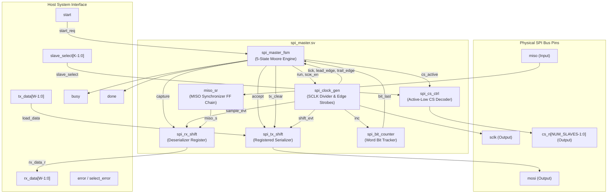
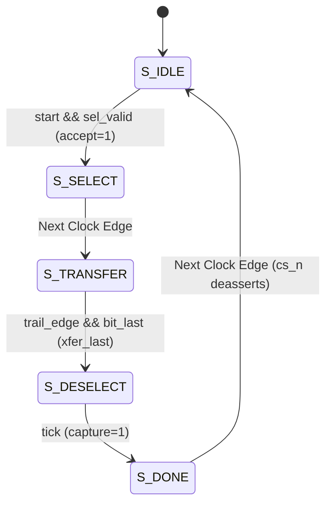
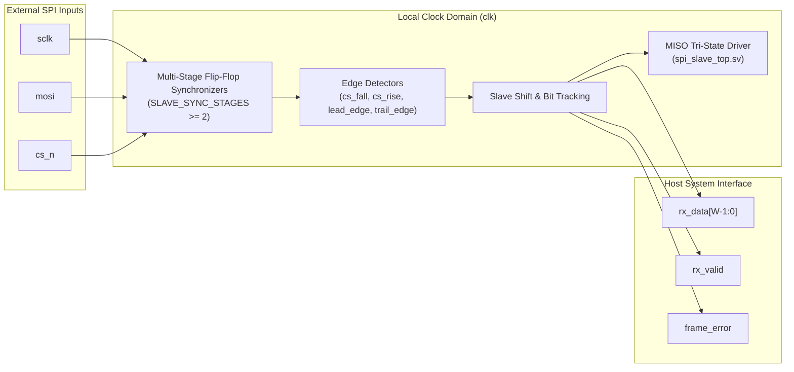
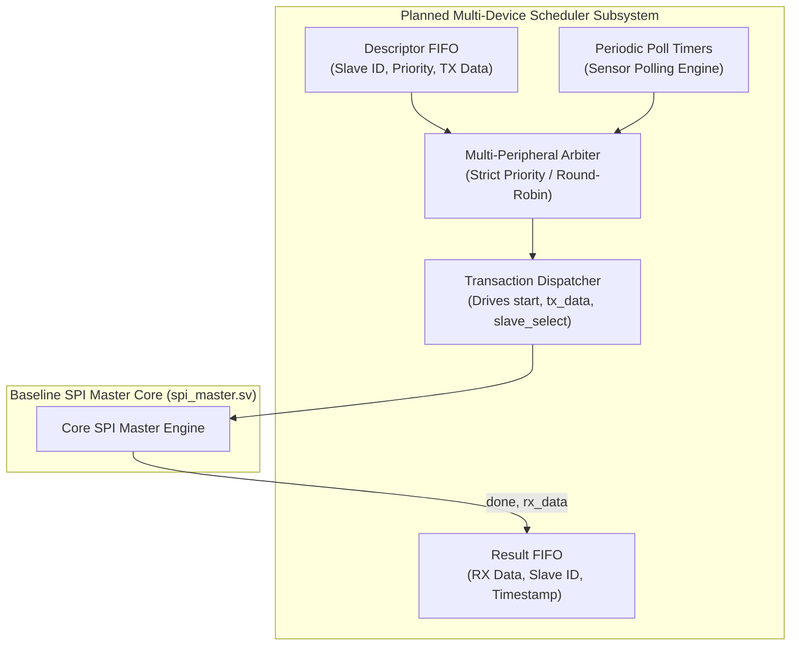
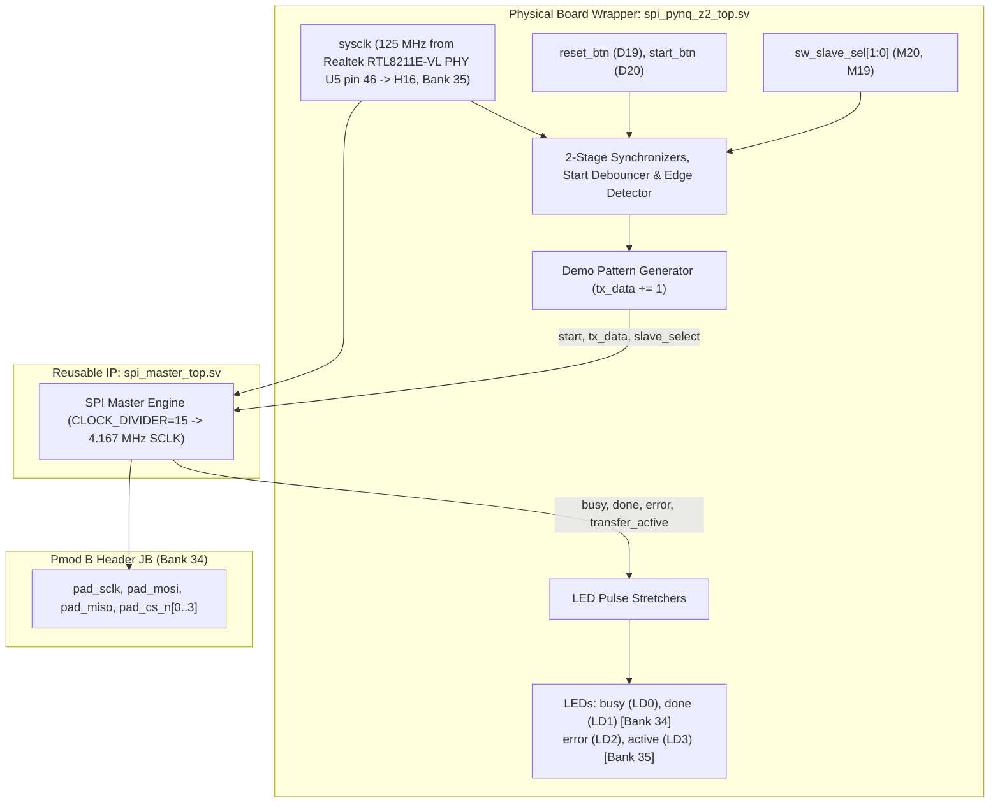

# System Architecture Specification

## 1. System Block Diagram

The Parameterized SPI IP Core comprises a modular hierarchy partitioned into synthesizable sub-blocks. The design enforces single-clock-domain synchronous operation throughout the core fabric.

---

## 2. SPI Communication Protocol & Operating Modes

SPI is a synchronous, four-wire protocol operating in full duplex:
- **`SCLK` (Serial Clock):** Generated exclusively by the SPI Master to synchronize data transfer.
- **`MOSI` (Master Out Slave In):** Serial data transmitted from Master to Slave.
- **`MISO` (Master In Slave Out):** Serial data transmitted from Slave to Master.
- **`CS_n` (Chip Select, Active-Low):** Dedicated line asserted low to select an individual peripheral.

### SPI Operating Modes

The relationship between clock polarity and sampling phase is governed by two parameters:
- **`CPOL` (Clock Polarity):** Defines the idle level of `sclk` when no transaction is active.
- **`CPHA` (Clock Phase):** Defines whether data is sampled on the leading (first) or trailing (second) clock edge of each bit cycle.

$$\text{SPI\_MODE} = \{\text{CPOL}, \text{CPHA}\}$$

| Mode | CPOL | CPHA | SCLK Idle State | Leading SCLK Edge | Trailing SCLK Edge | Data Sample Edge | Data Shift Edge |
|:---:|:---:|:---:|:---:|:---:|:---:|:---:|:---:|
| **0** | 0 | 0 | Low (`1'b0`) | Rising | Falling | Leading (Rising) | Trailing (Falling) |
| **1** | 0 | 1 | Low (`1'b0`) | Rising | Falling | Trailing (Falling) | Leading (Rising) |
| **2** | 1 | 0 | High (`1'b1`) | Falling | Rising | Leading (Falling) | Trailing (Rising) |
| **3** | 1 | 1 | High (`1'b1`) | Falling | Rising | Trailing (Rising) | Leading (Falling) |

### Mode 0 & Mode 1 vs. Preload Mechanics
- In **`CPHA = 0`** (Modes 0 & 2), the first data bit must be valid on `mosi` *before* the first clock edge. The TX shift register therefore preloads the MSB/LSB directly onto the output flip-flop upon transaction load.
- In **`CPHA = 1`** (Modes 1 & 3), `mosi` transitions on the leading edge and is sampled on the trailing edge. The output flip-flop is held at idle until the leading edge occurs.

---

## 3. SPI Master Subsystem Architecture

The SPI Master (`rtl/master/spi_master.sv`) coordinates transaction lifecycle execution through coordinated sub-blocks:

### A. Finite-State Machine (`spi_master_fsm.sv`)
The transaction controller is a deterministic 5-state Moore engine:
1. **`S_IDLE`:** Core is quiescent (`busy=0, done=0, cs_active=0`). Evaluates incoming `start` and `slave_select`. If valid, asserts `accept` for one clock cycle and transitions to `S_SELECT`.
2. **`S_SELECT`:** Duration: exactly 1 cycle (`busy=1`). `cs_active` is asserted, causing the registered `cs_n` decoder output to fall low on the subsequent clock edge. Provides setup time before SCLK toggles.
3. **`S_TRANSFER`:** Duration: exactly $2 \times W \times D$ system clock cycles (`busy=1, run=1, sclk_en=1`). SCLK actively toggles $2W$ times. Leaves when the final bit trailing edge occurs (`xfer_last`).
4. **`S_DESELECT`:** Duration: exactly $D$ system clock cycles (`busy=1, run=1, sclk_en=0`). SCLK is held idle at `CPOL`. Provides guaranteed hold time after serial transmission. On the final tick, `capture` pulses to latch deserialized data into the holding register.
5. **`S_DONE`:** Duration: exactly 1 cycle. **`busy=0`**, **`done=1`**. `cs_active=0` causes `cs_n` to return high on the transition back to `S_IDLE`.

### B. Clock Divider & Edge Generator (`spi_clock_gen.sv`)
The clock generator produces the serial clock and single-cycle timing strobes:
- **Counter Range:** Modulo-$D$ counter counting from $0$ to $D-1$, where $D = \text{CLOCK\_DIVIDER}$.
- **Strobe Signals:**
  - `tick`: Pulses for 1 clock cycle every $D$ clock cycles while `run = 1`.
  - `lead_edge`: Pulses when SCLK departs from the idle polarity (`CPOL`).
  - `trail_edge`: Pulses when SCLK returns to the idle polarity (`CPOL`).
- **Synchronous Output Register:** SCLK is generated directly from an internal flip-flop toggling on `tick && sclk_en`, preventing combinational clock glitches.

### C. Shift Registers (`spi_tx_shift.sv`, `spi_rx_shift.sv`)
- **Transmit Register:** Features registered serial output (`serial_out`). Configured by `PRELOAD_MSB` to support CPHA phase requirements. Supports both MSB-first (left shift) and LSB-first (right shift) without datapath duplication.
- **Receive Register:** Shift register sampling synchronized MISO. Handles single-bit word configurations ($W=1$) safely via generate logic without synthesis warnings.

### D. Chip Select Controller (`spi_cs_ctrl.sv`)
- Decodes binary `slave_select` into an active-low 1-hot `cs_n` bus of width `NUM_SLAVES`.
- Registered output stage ensures glitch-free CS transitions.
- Latches `slave_select` on transaction start, preventing mid-transaction address corruption.

---

## 4. SPI Slave Subsystem Architecture

The SPI Slave (`rtl/slave/spi_slave.sv`) operates synchronously within its own local clock domain:

### Key Slave Architectural Principles:
1. **No Derived Clocks:** Incoming `sclk` is treated as asynchronous serial data, oversampled by the slave's local clock `clk`.
2. **Oversampling Requirement:** $f_{clk\_slave} \ge 4 \times f_{sclk}$. SCLK half-period must span at least 2 local clock cycles for deterministic edge capture.
3. **Loopback Minimum Divider:** For master-slave loopback through pad wrappers, round-trip synchronizer delay requires:
   $$\text{CLOCK\_DIVIDER} \ge \text{MISO\_SYNC\_STAGES} + 4$$
4. **Frame Integrity Check:** Asserts `frame_error` upon `cs_n` deassertion if early frame truncation ($0 < \text{bits} < W$) or clock overrun ($> W$) is detected.

---

## 5. Telemetry & Diagnostic Subsystem (`spi_perf_counters.sv`)

The core integrates non-intrusive 32-bit hardware performance counters enabled via `ENABLE_PERF = 1`:
- `perf_txn_count`: Total completed transactions (`done` pulses).
- `perf_bits_total`: Cumulative payload bits transferred ($N_{txn} \times W$).
- `perf_busy_cycles`: Cumulative clock cycles with `busy = 1`.
- `perf_total_cycles`: Free-running cycle timer since reset or `perf_clear`.
- `perf_last_latency`: Cycle latency of most recent transaction ($2WD + D + 2$).
- `perf_last_sclk_cycles`: SCLK active toggling duration of most recent transaction ($2WD$).
- `perf_reject_count`: Count of rejected start attempts (`error` pulses).

> [!NOTE]
> These counters provide hardware telemetry and cycle-accurate diagnostic observability. They do not enforce arbitration policies or quality-of-service guarantees.

---

## 6. Multi-Device Transaction Scheduler Subsystem (Planned Extension)

The project explores an autonomous multi-device scheduler to coordinate transactions across heterogeneous peripherals:

> [!IMPORTANT]
> The Multi-Device Transaction Scheduler is currently in the architectural specification phase. The synthesizable RTL arbiter and descriptor queues are planned extensions and are not included in the baseline RTL.
>
> **Compile-Time vs. Runtime Configuration Distinction:**
> In the current synthesizable baseline core (`spi_master.sv`), protocol parameters (`SPI_MODE`, `CLOCK_DIVIDER`, `DATA_WIDTH`, and `LSB_FIRST`) are compile-time Verilog parameters uniform across all transactions. In contrast, the planned Multi-Device Scheduler subsystem is specified to introduce dynamic per-device transaction descriptors, enabling runtime reconfiguration of clock rate, SPI mode, and word length tailored to individual attached peripherals.

---

## 7. Board Demonstration Top & Integration Wrappers

1. **`spi_pad_wrapper.sv` (Simulation & Loopback):** Provides pad-level modeling, bidirectional tri-state MISO emulation, and self-testing loopback interconnect between master and an internal slave.
2. **`spi_pynq_z2_top.sv` (Hardware Lab Demonstration):** Bridges physical PYNQ-Z2 board pins (125 MHz clock on H16 from Ethernet PHY U5 pin 46, debounced pushbuttons, switches, LEDs) to the reusable IP core without requiring an external AXI master or unconstrained bitstream synthesis. SCLK operates at 4.167 MHz ($125\text{ MHz} / (2 \times 15)$), serving as a conservative initial operating target pending physical measurement (< 5 MHz recommended for unshielded Pmod headers).
