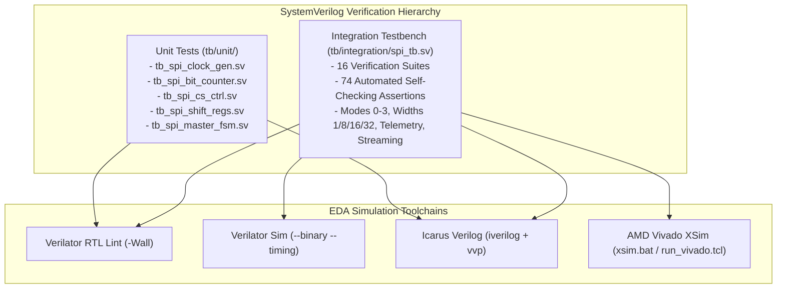

# Verification Plan and Strategy

## 1. Verification Strategy Overview

The verification strategy employs a layered SystemVerilog approach combining:
1. **Targeted Sub-Block Unit Tests:** Validating individual RTL primitives (`spi_clock_gen`, `spi_bit_counter`, `spi_cs_ctrl`, `spi_tx_shift`, `spi_rx_shift`, `spi_master_fsm`) against localized corner cases and interface contracts.
2. **Integrated Full-Duplex Loopback Simulation:** Validating the complete top-level IP core (`spi_pad_wrapper.sv`) with autonomous master-slave handshakes, multi-slave decoding, and telemetry measurements across 16 formal verification suites.
3. **Cross-Platform Tool Automation:** Supporting Verilator (lint and C++ binary compilation), Icarus Verilog (`iverilog -g2012`), and AMD Vivado XSim.



---

## 2. Verification Objectives & Test Matrix

The verification plan identifies 12 core functional categories:

| Category | Verification Objective | Target Subsystem | Test Location | Pass Criteria |
|---|---|---|---|---|
| **1. Reset Operation** | Verify quiescent output states, immediate abort on mid-transfer reset, and clean start recovery. | Master & Slave | `tb_spi_master_fsm.sv`<br>Suites 1, 13, 16 | All outputs return to idle within 1 clock cycle; no invalid `done` or spurious SCLK toggles. |
| **2. Clock Division** | Verify SCLK toggle frequency $f_{sclk} = f_{clk} / (2D)$ and half-period tick strobes. | `spi_clock_gen.sv` | `tb_spi_clock_gen.sv`<br>Suites 2–5 | Exactly $2WD$ clock cycles of SCLK activity per transaction. |
| **3. Divider Boundaries** | Verify minimum legal divider $D \ge \text{MISO\_SYNC\_STAGES} + 4$ ($D=5$ for 1 sync stage, $D=6$ for 2 sync stages). | `spi_pkg.sv`<br>`spi_master.sv` | Suite 15 | Error-free data transmission at minimum latency boundary. |
| **4. TX Data Shifting** | Verify MSB-first vs LSB-first serialization and CPHA preloading. | `spi_tx_shift.sv` | `tb_spi_shift_regs.sv`<br>Suites 2, 11 | First bit valid before SCLK edge on CPHA=0; valid after leading edge on CPHA=1. |
| **5. RX Data Capture** | Verify deserialization and safe holding register update in `S_DESELECT`. | `spi_rx_shift.sv` | `tb_spi_shift_regs.sv`<br>Suites 2–5 | `rx_data` matches expected word on `done` pulse and holds until next frame. |
| **6. Full-Duplex Transfer** | Verify simultaneous bidirectional transmission between Master and Slave. | `spi_pad_wrapper.sv` | Suites 2–5 | Master RX matches Slave TX while Slave RX matches Master TX. |
| **7. Data-Width Scaling** | Verify parameterization across $W \in \{1, 8, 16, 32\}$ bits. | Shift registers & bit counter | Suites 9, 10, 14 | Exact bit count verified without truncation or overflow. |
| **8. SPI Modes 0–3** | Verify protocol conformance across all four combinations of $\{CPOL, CPHA\}$. | Master & Slave | Suites 2, 3, 4, 5 | SCLK idle state and sampling edges adhere to protocol mode definitions. |
| **9. Chip Select Dec** | Verify 1-hot mutual exclusion across $N \ge 1$ chip select outputs. | `spi_cs_ctrl.sv` | `tb_spi_cs_ctrl.sv`<br>Suite 12 | Exactly one `cs_n` bit low during transfer; unselected bits remain high. |
| **10. Master-Slave Sync** | Verify asynchronous input oversampling and frame error detection. | `spi_slave.sv` | Suite 2–5 | `frame_error` remains low during valid frames; asserts on truncated frames. |
| **11. Streaming Transfers** | Verify back-to-back zero-overhead streaming when `start` is held high. | Master FSM | Suite 8 | Latency between consecutive `done` pulses equals $2WD + D + 3$ cycles. |
| **12. Error & Rejection** | Verify distinct assertions of `error` and `select_error` on illegal transactions. | Master Core | Suite 7 | Out-of-bounds `slave_select` triggers both flags; busy rejection triggers `error` only. |

---

## 3. Integration Testbench Suite Catalog (`tb/integration/spi_tb.sv`)

The self-checking integration testbench implements **16 structured test suites**. The SystemVerilog source contains **58 static `check_result` calls**. At runtime, iterative loops in Test 8 (4 iterations) and Test 12 (4 slave selections $\times$ 1 active check + 3 mutual-exclusion checks) execute a total of **74 dynamic assertions**:

```text
Suite 01: Reset & Idle Pin Verification (7 checks)
Suite 02: SPI Mode 0 Full-Duplex Loopback (4 checks)
Suite 03: SPI Mode 1 Full-Duplex Loopback (2 checks)
Suite 04: SPI Mode 2 Full-Duplex Loopback (2 checks)
Suite 05: SPI Mode 3 Full-Duplex Loopback (2 checks)
Suite 06: Performance & Diagnostic Telemetry Verification (5 checks)
Suite 07: Error Detection & Semantic Separation (5 checks)
Suite 08: Back-to-Back Consecutive Streaming Transfers (4 checks dynamically in loop)
Suite 09: 16-Bit Word Transfer Parameterization (2 checks)
Suite 10: 32-Bit Word Transfer Parameterization (2 checks)
Suite 11: LSB-First Bit Ordering Full-Duplex Transfer (2 checks)
Suite 12: Multi-Slave 1-Hot CS Decoding & Mutual Exclusion (17 checks dynamically: 4 assert + 12 idle + 1 final)
Suite 13: Synchronous Reset During Active Transaction (5 checks)
Suite 14: Single-Bit Word Transfer Boundary (4 checks)
Suite 15: Minimum Legal Clock Divider Boundary (3 checks)
Suite 16: Reset Lifecycle Verification (Reset-Before & Reset-After Transfer: 8 checks)
Total: 74 Automated Runtime Checks (100% Passing)
```

---

## 4. Execution Commands & Reproduction

### Verilator RTL & Full Testbench Lint
```bash
python sim/run_sim.py lint
# or via Makefile
make -C sim lint
```

### Modular Unit Testbenches
```bash
# Run all 5 unit testbenches in sequence
python sim/run_sim.py unit
# or via Makefile
make -C sim unit

# Run individual unit tests
python sim/run_sim.py clock_gen     # SCLK generator unit test
python sim/run_sim.py bit_counter   # Bit counter unit test
python sim/run_sim.py cs_ctrl       # Chip-select controller unit test
python sim/run_sim.py shift_regs    # TX/RX shift registers unit test
python sim/run_sim.py master_fsm    # Master transaction FSM unit test
```

### Icarus Verilog Integration Simulation
```bash
python sim/run_sim.py integration
# or via Makefile
make -C sim integration
```

### Verilator Modern Simulation
```bash
python sim/run_sim.py sim
# or via Makefile
make -C sim sim
```

### AMD Vivado XSim Functional Simulation
```bash
vivado -mode batch -notrace -source scripts/vivado/run_vivado.tcl -tclargs -mode sim
```

---

## 5. Truthful Reporting of Verification Results

> [!NOTE]
> - **Continuous Integration (CI):** The integration testbench (`spi_tb.sv`) is verified via GitHub Actions (`.github/workflows/spi-ci.yml`) using Verilator 5.032 and Icarus Verilog 12.0, passing all 74 assertions with zero errors.
> - **Local Tool Availability:** On host development machines without local EDA installations, automated CI provides the primary authoritative execution log.
> - **Planned Extensions:** Multi-device scheduler testbenches will be introduced in milestone M4 upon completion of scheduler RTL.
